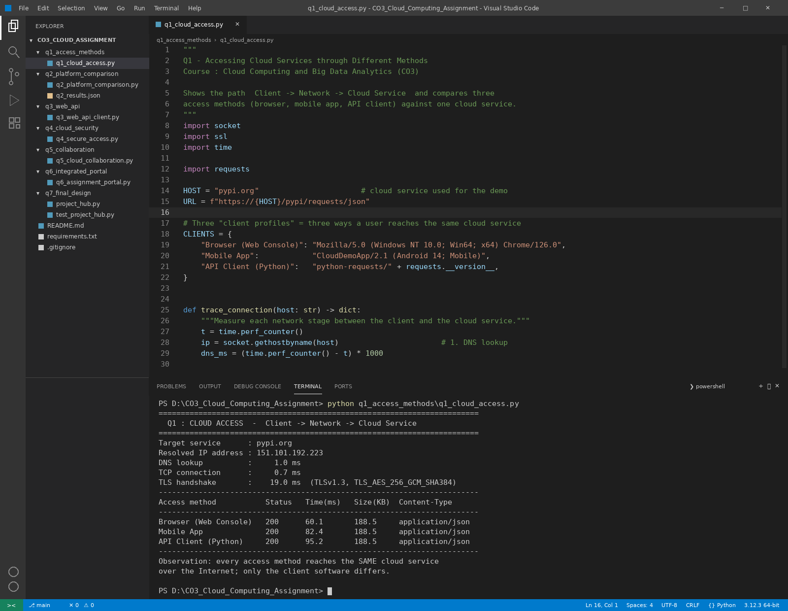
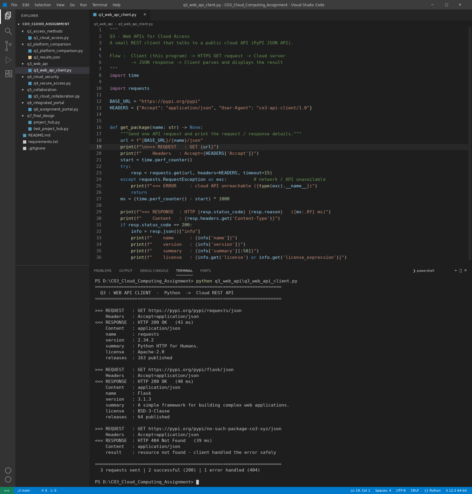
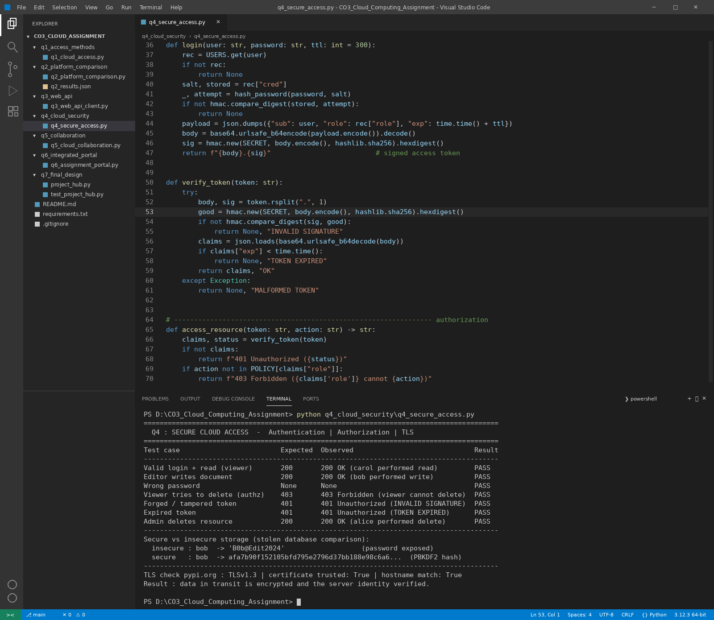
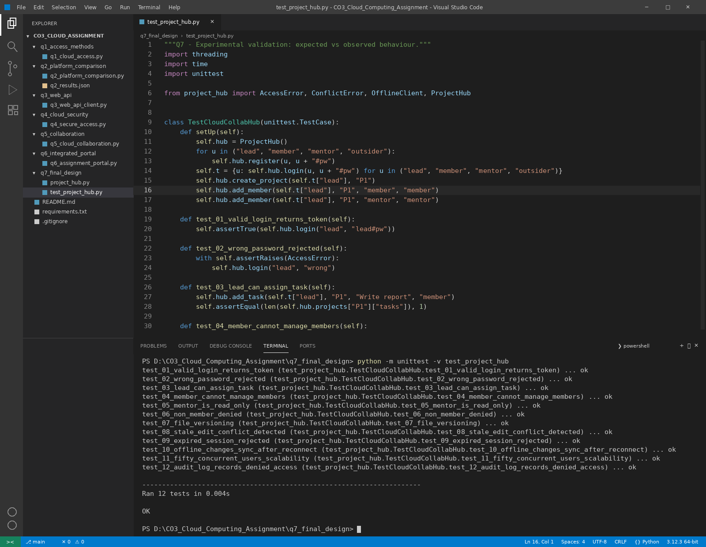
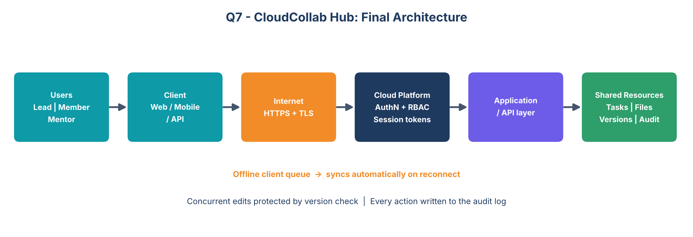

# ☁️ CO3 Assignment 3 – Cloud Computing and Big Data Analytics

> **CO3:** Implement cloud-based solutions using cloud storage, web APIs, and platform services for real-world applications.

Pair-work assignment covering cloud access, platforms, Web APIs, security, collaboration and a complete cloud-based design (**CloudCollab Hub**).


---

## 📁 Repository Structure

| Folder | Question | Description |
|---|---|---|
| `q1_access_methods/` | Q1 | Client → Network → Cloud Service: DNS/TCP/TLS timings and 3 access methods |
| `q2_platform_comparison/` | Q2 | Compares two cloud platforms (PyPI, npm Registry) and maps request → service |
| `q3_web_api/` | Q3 | REST API client for the PyPI JSON API with 3 test inputs |
| `q4_cloud_security/` | Q4 | Authentication, signed tokens, RBAC authorization, TLS check (7 test cases) |
| `q5_collaboration/` | Q5 | Shared workspace: roles, versions, conflict detection, audit log |
| `q6_integrated_portal/` | Q6 | Cloud assignment submission & evaluation REST prototype |
| `q7_final_design/` | Q7 | CloudCollab Hub implementation + 12 unit tests |
| `diagrams/` | – | Architecture and flow diagrams used in the report |
| `screenshots/` | – | VS Code execution evidence for every program |
| `docs/` | – | Word report |

---

## 🚀 How to Run

**Requirements:** Python 3.9+ and an Internet connection (Q1–Q4 contact public cloud services).

```bash
git clone https://github.com/<your-username>/CO3_Cloud_Computing_Assignment.git
cd CO3_Cloud_Computing_Assignment
pip install -r requirements.txt

python q1_access_methods/q1_cloud_access.py
python q2_platform_comparison/q2_platform_comparison.py
python q3_web_api/q3_web_api_client.py
python q4_cloud_security/q4_secure_access.py
python q5_collaboration/q5_cloud_collaboration.py
python q6_integrated_portal/q6_assignment_portal.py

# Q7
cd q7_final_design
python project_hub.py
python -m unittest -v test_project_hub
```

Run the commands from the repository root (Q7 from inside `q7_final_design`).

---

## 🖼️ Execution Evidence

| Q1 – Cloud access | Q3 – Web API client |
|---|---|
|  |  |

| Q4 – Cloud security | Q7 – Unit tests |
|---|---|
|  |  |

All screenshots: [`screenshots/`](screenshots/)

---

## 🏗️ Final Design – CloudCollab Hub (Q7)

`Users → Client → Internet (HTTPS) → Cloud Platform → Application/API → Shared Resources`

- Roles: **lead**, **member**, **mentor (read-only)**
- Hashed passwords + expiring session tokens + role-based authorization
- Versioned files with conflict detection and an audit log
- Offline queue that synchronises after reconnection
- Validated with 12 test cases including a 50-user concurrency test



---

## ⚠️ Notes

- Q3 uses the public **PyPI JSON API** (no key required). Public APIs may apply rate limits.
- The Q6 portal runs locally on port `5050` as a stand-in for a cloud server.
- Demo credentials in the code are for learning only – never hard-code secrets in real projects.

## 👥 Team

| Role | Name | Reg. No. |
|---|---|---|
| Student A | _Your name_ | _Reg. no._ |
| Student B | _Your name_ | _Reg. no._ |

## 📜 License
Submitted for academic evaluation. Add a license of your choice before sharing publicly.
